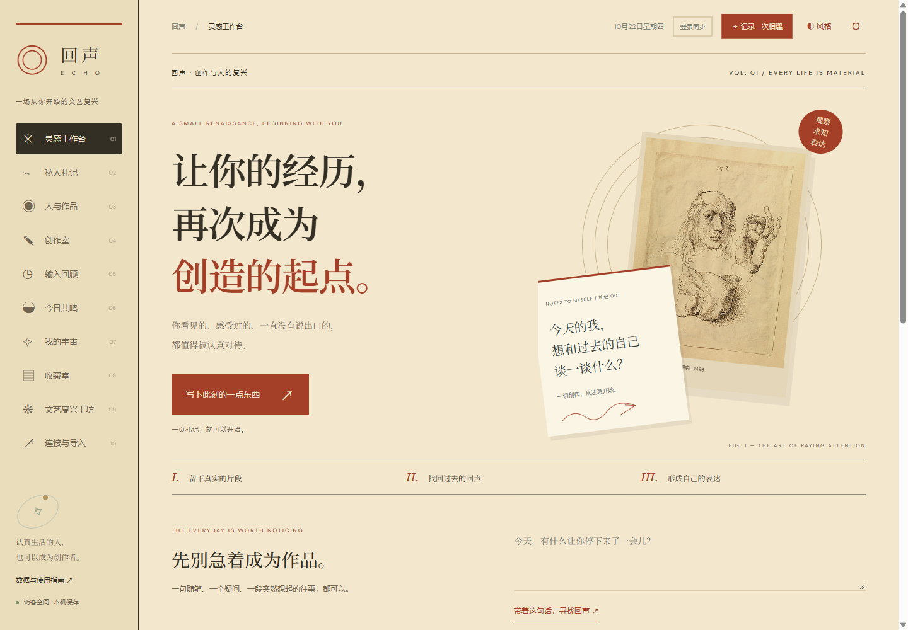

# 回声 ECHO · 一场从人开始的文艺复兴


**早期可运行版本 · Human-centered inspiration & writing**

[在线体验](https://echo-cultural-universe-wit.youngcoin22.chatgpt.site/echo/#atelier) · [运行与部署](docs/DEPLOYMENT.md) · [素材署名与许可](THIRD_PARTY_NOTICES.md)



把过去的阅读、观影和听歌经历，变成有来源的个人理解与自己的作品；让作品带着一个人的经历与问题，走向另一个人。

## 从一页札记开始

默认入口是「灵感工作台」。在「私人札记」写随笔、观察或一段自己的经历，按需填写自由标签与真实发生日期。草稿自动保存在本机，登录后同步私人云端；记录日期与经历日期分开。右侧基于分词、文字与主题标签找回旧札记、回忆、已体验作品的短评，逐条显示关联依据，由用户确认连接。找不到时留空，不杜撰往事，也不把示例收藏当成用户经历。

「创作罗盘」让用户亲自填写问题、个人缘由、预期读者和表达形式，再带选定材料进入创作室。个人札记、回忆与罗盘保持私密，正文初始为空；确定发布时仅公开自己写的正文与选定的书影音/历史出处。

「文艺复兴工坊」用达·芬奇札记、丢勒观察页与版画传播三个官方来源支持的案例，提供明确标注为当代设计的5分钟练习。主视觉使用Met公开领域/CC0的1493年丢勒习作，署名与许可见 `public/echo/renaissance/attribution.json`。倡议聚焦当代人的观察与表达，不将现代练习冒充历史人物原话。

## 书影音与创作路径

1. 打开网站，访客可先体验示例；登录后拥有独立云端空间。
2. 在「连接与导入」自主导入豆伴 Excel、NeoDB CSV、通用 CSV；或连接 neodb.social，完成正式只读 OAuth 后逐页读取个人记录。
3. 在「输入回顾」重访时间线，补充当时的回忆，查看反复出现的主题。
4. 从创作线索建立随笔、视频脚本或播客项目，选择作品作为材料。
5. 在创作室查看自己的短评和回忆，写正文、插入作品出处、预览，导出 Markdown 或独立 HTML。
6. 愿意时明确分享当前版本，填写公开署名、介绍与创作问题；读者可以访问作者页，从作品建立自己的私人回应草稿。可以撤回公开版，私人稿件保留。

## 视觉风格

顶栏「◐ 风格」选择空间默认主题，随账号同步，也写入 JSON 备份。默认「昨日刊物」取意七八十年代书刊：奶油纸、砖红油墨、橄榄绿、杂志分栏；还可选择「银幕留白」「苔绿手稿」「回声书房」。原作封面保持原貌。

每件作品的「选择 / 获取建议」可固定自己的风格，或跟随平台。建议只依据创作形式与所选素材的标签给出，不分析人格、不自动替换。阅读预览和独立 HTML 使用作品风格；Markdown 是纯文本。公开版本在作者确认分享时固定当时的风格，后续切换空间主题或编辑草稿不会改变已发布版，需主动更新公开版本。旧的公开版本无风格字段时按原有书房配色展示。

## 账号与存储

网站入口可面向访客开放。公开作品是作者确认分享的快照，草稿编辑不会自动更新公开版；作品引用仅包含选定元数据，不带出私人的短评与回忆。匿名访客只能读主动公开的作品，不能读取他人的 vault。Sites 提供登录身份，API 只按服务端收到的用户 ID 读取和写入自己的数据。没有匿名云端写入。访客使用本机空间；旧版本机记录可登录后主动迁移。

收藏、回忆、手记与创作项目自动同步到 D1；按版本比较，检测到另一设备有更新时要求显式合并。不同 ID 的记录都保留，同 ID 采用本机版本，合并前可以导出备份。空间总同步上限 8MB；较大的历史分块存储，不受单行2MB限制。超出时会明确提示，本机内容仍可备份。

服务端状态按账号隔离；退出登录后不会继续显示刚才账号的项目。浏览器缓存不等于加密保险箱，共用设备时应退出账号并妥善保管本机备份。

## 豆瓣与 NeoDB

豆瓣官方授权目前没有可核实的新应用申请通道，本项目没有伪授权按钮，也不会要求密码或 Cookie。豆瓣导入只处理豆伴实际格式的九张书影音收藏表，忽略联系人、豆邮、日记等其他表。导入先预览、确认后保存；个人五星与豆瓣大众分分开识别。缺失日期保留为未知，不填成今天。

NeoDB 使用当前官方 OAuth 协议，仅申请 `read`，限定 `neodb.social`；应用凭据与临时 token 保存在服务端 D1，不进入前端或用户导出备份。OAuth state 绑定当前账号、本站来源与有效期。读取完成会请求撤销 token；若未取得撤销确认、读取中断或授权过期，用户可在回声重试撤销，或到 NeoDB 管理应用授权。个人授权本身必须由用户在 NeoDB 确认，测试账号与模拟数据不会代替真实授权。

CSV 去重按来源链接，缺失链接时按类型、标题、创作者。JSON 备份按 ID 合并。NeoDB CSV 支持官方 `title,info,links,timestamp,status,rating,comment,tags`，十分制个人分转成五星；原生 NDJSON/ZIP 尚不支持。

## 内容、封面与创作辅助

18 部精选作品使用真实缩略封面，图片和出处在 `public/echo/covers` 与 `cover-manifest.json`。自定义作品可查找封面候选，核对标题与创作者后保存，也可填写自己的 HTTPS 封面链接。未知作品不会用随机图片冒充。

主题汇总来自作品标签与用户短评，线索附有实际来源，不作人格判断。创作室提供材料与结构，正文由用户撰写；没有大模型代写或虚构个人经历。此版本不提供音乐、电影或图书原文播放。

## 开发

Node.js 24（建议使用较新的补丁版本），首次安装与本地数据库初始化：

```powershell
npm ci
npm run db:local
npm run dev -- --port 5182

# 验证
npm run check
npm test
npm run typecheck
npm run build
```

Windows 某些 npm shell shim 不兼容时，可直接用 Node 运行 `scripts/run-framework.mjs dev --port 5182` 或 `build`。旧 Node 24.12 在此环境复制文件时崩溃，本项目验证使用 24.19。

`npm run db:local` 只应用尚未执行的本地迁移，不需要云账号。开发登录使用模拟身份。生产版本依赖可信身份入口与 D1 绑定，不能把当前身份头适配器直接当作独立认证服务。参见 [运行与部署边界](docs/DEPLOYMENT.md)。

`public/echo` 是前端源码；`app/api` 是受保护的服务端入口；`lib` 是云端存储、校验与 OAuth；`tests` 验证关联、导入、来源、账号隔离、冲突与协议流程。`dist` 为生成目录，不应手动编辑。Sites 发布保留原项目身份。

更多说明：`docs/产品思考.md`、`docs/豆瓣与账号接入.md`、`docs/验证记录.md`。

## 项目状态与许可

已有完整的记录—关联—创作—自选分享路径和26项自动测试。关联目前基于分词与标签，没有接入向量检索或大模型代写；历史练习目前为三组官方资料支持的案例。真实用户需求与长期留存尚未验证。

本仓库先作为私人项目存档，尚未为原创代码选择通用开源许可证。历史图像、封面和随附第三方代码的使用条件见 [THIRD_PARTY_NOTICES.md](THIRD_PARTY_NOTICES.md)。
