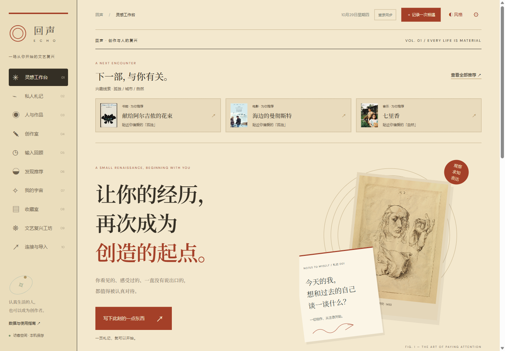
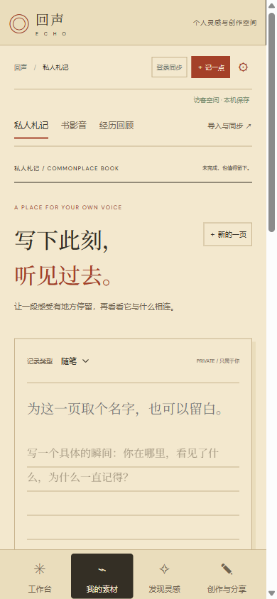

# 回声：从个人经历走向自己的作品

回声面向有阅读、观影、听音乐习惯，也希望记录与表达自己的人。它把私人札记、生活经历和文化输入放在一起，帮助人发现反复在意的问题，并逐步形成自己的作品。

主线：**记录片段 → 找回联系 → 形成表达**。推荐和星空提供新的材料与探索线索，服务于个人理解和创作。

## 四个主入口

| 主入口 | 用户来这里做什么 | 内部功能 |
| --- | --- | --- |
| 工作台 | 记下一点，或接着上次创作 | 片段草稿、最近作品、个人线索、三部推荐 |
| 我的素材 | 安放和重访自己的经历 | 私人札记、书影音、经历回顾；导入与同步作为辅助工具 |
| 发现灵感 | 从作品与历史里获得新的刺激 | 为你推荐、3D 星空、创作练习 |
| 创作与分享 | 写成自己的作品，再决定分享 | 我的作品、作品广场；阅读页和作者页归入这里 |

首页首屏保留记录与继续创作两个明确任务。推荐位于下方。自己的材料数量只统计真实个人记录；示例推荐不计入个人数量。创作页优先显示我的作品，素材建议默认折叠。

手机使用四项底部导航，二级功能只在所属页面出现。原有页面地址保持可用，旧札记地址、公开阅读和作者直达链接都有明确的导航归属。

## 本次体验检查（2026-10-29）

1. **旧首页：入口层级不清楚。** 十项导航平级出现，推荐先于记录，大幅宣传内容占据首屏。用户需要先理解功能名称才能决定下一步。

   

2. **新工作台：首要任务明确。** 四个主入口，首屏提供片段输入与继续创作；推荐作为后续探索。已检查首页片段可原样带入私人札记。

   

3. **手机素材页：功能按任务聚合。** 四项底部导航覆盖完整可视宽度；札记、书影音、回顾置于页内，导入同步作为辅助入口。390px 检查没有横向溢出，当前主入口与子页面均有状态标记。

   

浏览器检查覆盖全部11个普通页面和旧札记入口、主导航归属、二级选中状态、手机溢出、创作建议折叠、首页草稿传递。新增导航测试检查唯一归属、深链接兼容和二级工具入口，与原有测试合计29项通过；另完成源码语法、类型和生产构建检查。

截图只说明所检查视口的表现；未进行真实用户任务成功率研究，也不据此声称已完成全部无障碍验证。
